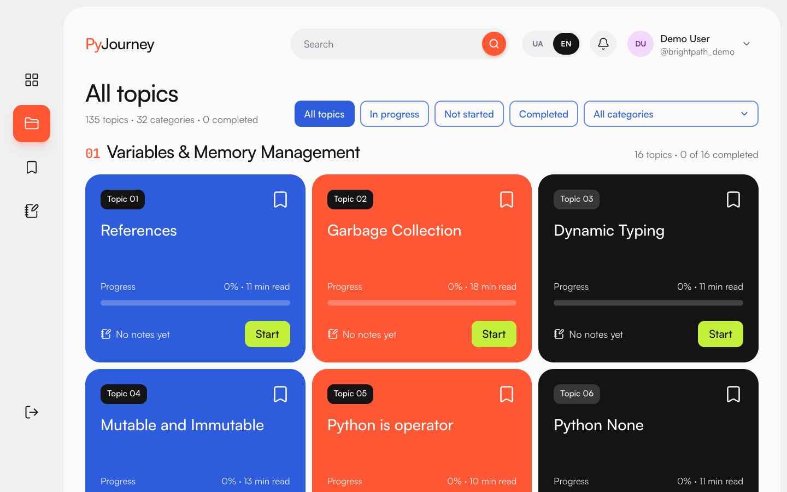
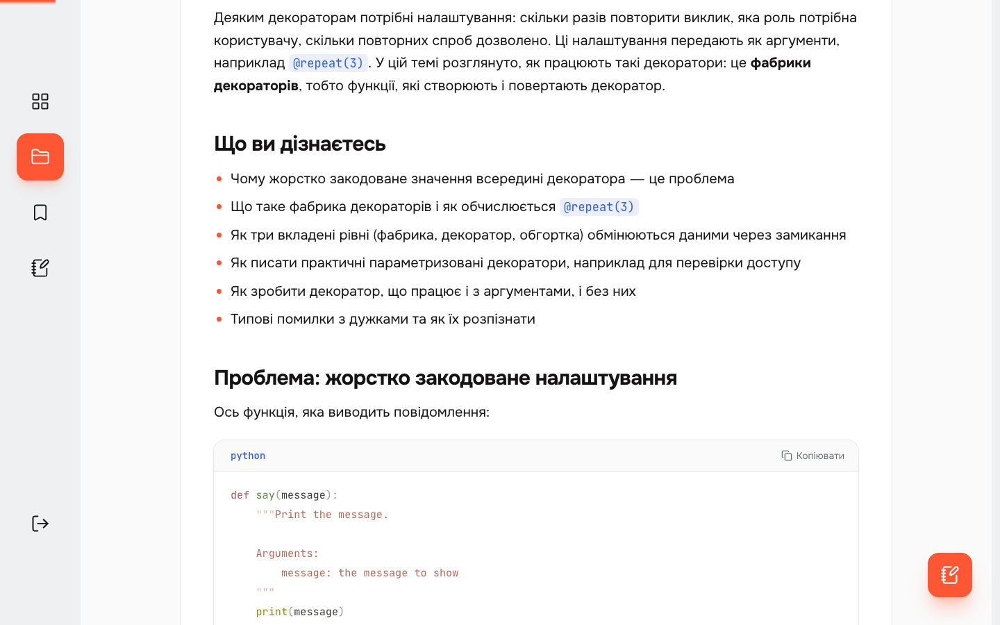
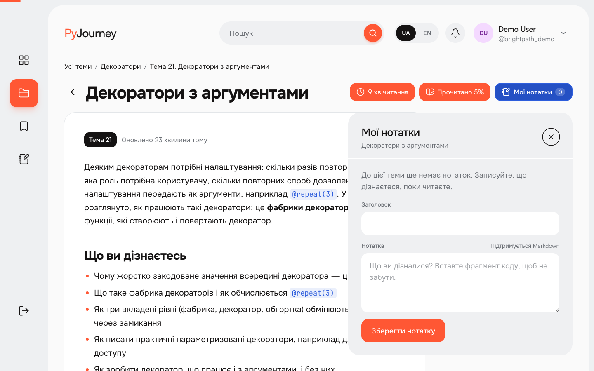

<div align="center">

# PyJourney

**Learn Python one topic at a time — in English and Ukrainian.**

[Українська версія](README.uk.md) · [All topics](topics/README.md) · [API docs](#api)

</div>

PyJourney is a web app for studying Python step by step. It contains **135 topics in 32 categories**, from variables and memory management to asyncio, design patterns and NumPy. Every topic is written in English and Ukrainian, and learners can keep their own notes next to the material.



## Features

- **135 bilingual topics.** Each topic explains the idea, shows runnable examples, lists common mistakes, and ends with practice exercises and solutions. All examples were run on Python 3.14, and the outputs shown are real.
- **32 categories** in the order of the course: the topics page groups them by category and can be filtered by category or progress.
- **English and Ukrainian interface.** Switch the language at any time with the UA / EN toggle. The topic text, titles, dates and plurals follow the selected language.
- **Personal notes** in Markdown, written in a side panel right next to the topic.
- **Reading progress, recent topics and suggestions** on the home page, plus bookmarks for topics you want to come back to.
- **Admin editor** to create and edit topics in both languages, with a live Markdown preview and a category picker.
- **Accounts and roles**: registration, JWT sign-in, and `admin` / `user` roles.

| Reading a topic | Notes next to the material |
|---|---|
|  |  |

## Topics

Each category has its own folder in [`topics/en`](topics/en) and [`topics/uk`](topics/uk). The full list of topics with links is in [topics/README.md](topics/README.md).

| # | Category | Topics | Read |
|---|---|---|---|
| 01 | [Variables & Memory Management](topics/README.md#01) | 16 | [English](topics/en/01-variables-and-memory-management) · [Українська](topics/uk/01-variables-and-memory-management) |
| 02 | [Variable Scopes](topics/README.md#02) | 2 | [English](topics/en/02-variable-scopes) · [Українська](topics/uk/02-variable-scopes) |
| 03 | [Closures](topics/README.md#03) | 1 | [English](topics/en/03-closures) · [Українська](topics/uk/03-closures) |
| 04 | [Decorators](topics/README.md#04) | 3 | [English](topics/en/04-decorators) · [Українська](topics/uk/04-decorators) |
| 05 | [Sequence Types](topics/README.md#05) | 4 | [English](topics/en/05-sequence-types) · [Українська](topics/uk/05-sequence-types) |
| 06 | [Iterables & Iterators](topics/README.md#06) | 3 | [English](topics/en/06-iterables-and-iterators) · [Українська](topics/uk/06-iterables-and-iterators) |
| 07 | [Generators](topics/README.md#07) | 2 | [English](topics/en/07-generators) · [Українська](topics/uk/07-generators) |
| 08 | [Context Managers](topics/README.md#08) | 1 | [English](topics/en/08-context-managers) · [Українська](topics/uk/08-context-managers) |
| 09 | [Multithreading & Multiprocessing](topics/README.md#09) | 6 | [English](topics/en/09-multithreading-and-multiprocessing) · [Українська](topics/uk/09-multithreading-and-multiprocessing) |
| 10 | [Classes & Objects](topics/README.md#10) | 9 | [English](topics/en/10-classes-and-objects) · [Українська](topics/uk/10-classes-and-objects) |
| 11 | [Special Methods](topics/README.md#11) | 6 | [English](topics/en/11-special-methods) · [Українська](topics/uk/11-special-methods) |
| 12 | [Property](topics/README.md#12) | 4 | [English](topics/en/12-property) · [Українська](topics/uk/12-property) |
| 13 | [Single Inheritance](topics/README.md#13) | 5 | [English](topics/en/13-single-inheritance) · [Українська](topics/uk/13-single-inheritance) |
| 14 | [Enumerations](topics/README.md#14) | 4 | [English](topics/en/14-enumerations) · [Українська](topics/uk/14-enumerations) |
| 15 | [SOLID Principles](topics/README.md#15) | 5 | [English](topics/en/15-solid-principles) · [Українська](topics/uk/15-solid-principles) |
| 16 | [Multiple Inheritance](topics/README.md#16) | 1 | [English](topics/en/16-multiple-inheritance) · [Українська](topics/uk/16-multiple-inheritance) |
| 17 | [Descriptors](topics/README.md#17) | 2 | [English](topics/en/17-descriptors) · [Українська](topics/uk/17-descriptors) |
| 18 | [Meta Programming](topics/README.md#18) | 4 | [English](topics/en/18-meta-programming) · [Українська](topics/uk/18-meta-programming) |
| 19 | [Exceptions](topics/README.md#19) | 5 | [English](topics/en/19-exceptions) · [Українська](topics/uk/19-exceptions) |
| 20 | [Introduction to unittest](topics/README.md#20) | 4 | [English](topics/en/20-introduction-to-unittest) · [Українська](topics/uk/20-introduction-to-unittest) |
| 21 | [Assert Methods](topics/README.md#21) | 7 | [English](topics/en/21-assert-methods) · [Українська](topics/uk/21-assert-methods) |
| 22 | [Test Doubles](topics/README.md#22) | 4 | [English](topics/en/22-test-doubles) · [Українська](topics/uk/22-test-doubles) |
| 23 | [Test Coverage & Parameterized Tests](topics/README.md#23) | 2 | [English](topics/en/23-test-coverage-and-parameterized-tests) · [Українська](topics/uk/23-test-coverage-and-parameterized-tests) |
| 24 | [Basic Regular Expressions](topics/README.md#24) | 4 | [English](topics/en/24-basic-regular-expressions) · [Українська](topics/uk/24-basic-regular-expressions) |
| 25 | [Quantifiers](topics/README.md#25) | 3 | [English](topics/en/25-quantifiers) · [Українська](topics/uk/25-quantifiers) |
| 26 | [Sets & Ranges](topics/README.md#26) | 1 | [English](topics/en/26-sets-and-ranges) · [Українська](topics/uk/26-sets-and-ranges) |
| 27 | [Groupings](topics/README.md#27) | 4 | [English](topics/en/27-groupings) · [Українська](topics/uk/27-groupings) |
| 28 | [Look Around](topics/README.md#28) | 2 | [English](topics/en/28-look-around) · [Українська](topics/uk/28-look-around) |
| 29 | [Regex Functions](topics/README.md#29) | 9 | [English](topics/en/29-regex-functions) · [Українська](topics/uk/29-regex-functions) |
| 30 | [asyncio — Asynchronous I/O](topics/README.md#30) | 1 | [English](topics/en/30-asyncio) · [Українська](topics/uk/30-asyncio) |
| 31 | [Design Patterns](topics/README.md#31) | 10 | [English](topics/en/31-design-patterns) · [Українська](topics/uk/31-design-patterns) |
| 32 | [NumPy](topics/README.md#32) | 1 | [English](topics/en/32-numpy) · [Українська](topics/uk/32-numpy) |

The material is adapted and expanded from [pythontutorial.net](https://www.pythontutorial.net/), [Refactoring.Guru](https://refactoring.guru/design-patterns) (design patterns), [numpy.org](https://numpy.org/) and [docs.python.org](https://docs.python.org/3/). The source of every topic is linked at the end of its file.

## Tech stack

| Part | Technologies |
|---|---|
| Backend | Python 3.12, FastAPI, SQLAlchemy, Alembic, Pydantic, PyJWT, pwdlib (Argon2) |
| Database | PostgreSQL 13, pgAdmin |
| Frontend | React 19, TypeScript, Vite, TanStack Router, TanStack Query, Tailwind CSS 4 |
| Content | Markdown with GitHub Flavored Markdown, Shiki syntax highlighting |
| Tooling | Docker Compose, Biome, React Compiler |

## Project structure

```text
PyJourney/
├── app/                    FastAPI backend
│   ├── alembic/            database migrations
│   ├── routes/             auth, categories, topics, notes
│   ├── schemas/            Pydantic request and response models
│   ├── models.py           SQLAlchemy models
│   ├── seed_topics.py      loads the topics/ folder into the database
│   └── main.py
├── frontend/               React app
│   └── src/
│       ├── routes/         pages
│       ├── features/       topics, notes, profile, auth
│       ├── components/     layout, UI kit, Markdown renderer
│       └── lib/            API client, queries, translations
├── topics/                 study material
│   ├── categories.json     category names in both languages
│   ├── en/                 English topics
│   └── uk/                 Ukrainian topics
├── design/                 design mockups
├── docker-compose.yml
└── Dockerfile
```

## Getting started

You need [Docker](https://www.docker.com/) with Docker Compose and [Node.js](https://nodejs.org/) 22.12 or newer.

**1. Create a `.env` file** in the project root:

```bash
DB_HOST=db
DB_NAME=devdb
DB_USER=devuser
DB_PASS=changeme
DATABASE_URL=postgresql://devuser:changeme@db:5432/devdb
SECRET_KEY=replace-with-a-long-random-string
PGADMIN_DEFAULT_EMAIL=admin@example.com
PGADMIN_DEFAULT_PASSWORD=changeme
```

Generate a secret key with `python3 -c "import secrets; print(secrets.token_hex(32))"`.

**2. Start the backend, the database and pgAdmin:**

```bash
docker compose up -d --build
```

**3. Prepare the database schema.** On a new database the API creates the tables when it starts, so you only need to mark the migrations as applied:

```bash
docker compose exec app alembic stamp head
```

If you are updating an existing database from an older version, run `docker compose exec app alembic upgrade head` instead.

**4. Load the topics:**

```bash
docker compose exec app python seed_topics.py
```

**5. Start the frontend:**

```bash
cd frontend
npm install
npm run dev
```

Open <http://localhost:5500> and create an account.

**6. Make yourself an admin** to create and edit topics:

```bash
docker compose exec db psql -U devuser -d devdb -c "UPDATE users SET role = 'admin' WHERE username = 'your_username';"
```

| Service | Address |
|---|---|
| Web app | <http://localhost:5500> |
| API and Swagger UI | <http://localhost:8000/docs> |
| PostgreSQL | `localhost:5001` |
| pgAdmin | <http://localhost:5050> |

## Working with topics

Every topic is a Markdown file that starts with a `# Title` line. A topic has the same file name in both languages:

```text
topics/en/04-decorators/02-python-decorator-with-arguments.md
topics/uk/04-decorators/02-python-decorator-with-arguments.md
```

The number prefixes set the order of categories and topics. Category names live in [`topics/categories.json`](topics/categories.json).

After you add or edit files, load them into the database again:

```bash
docker compose exec app python seed_topics.py
```

The script updates existing topics by their path, so topic IDs and learners' notes are kept. It stops with an error if a topic is missing in one of the languages. To start from scratch, add `--reset`: it deletes **all notes, topics and categories** before loading.

Admins can also create and edit topics in the app. Changes made there are stored in the database only, so copy them to the Markdown files if you want to keep them in the repository.

## API

Interactive documentation is available at <http://localhost:8000/docs>.

| Method | Path | Access | Description |
|---|---|---|---|
| `POST` | `/auth/` | public | Register a user |
| `POST` | `/auth/token` | public | Sign in and get a JWT |
| `GET` | `/auth/me` | user | Current user |
| `GET` | `/categories/` | public | Categories in course order |
| `GET` | `/topics/` | public | Topic list with titles, excerpts and reading time (`category_id`, `skip`, `limit`) |
| `GET` | `/topics/topics/{id}` | public | Full topic in both languages |
| `POST` | `/topics/topics` | admin | Create a topic |
| `PUT` | `/topics/topics/{id}` | admin | Update a topic |
| `DELETE` | `/topics/topics/{id}` | admin | Delete a topic and its notes |
| `GET` | `/notes/` | user | Your notes |
| `POST` | `/notes/notes` | user | Create a note |
| `PUT` | `/notes/notes/{id}` | user | Update your note |
| `DELETE` | `/notes/notes/{id}` | user | Delete your note |

## Frontend scripts

| Command | What it does |
|---|---|
| `npm run dev` | Development server on port 5500, with `/api` proxied to the backend |
| `npm run build` | Type check and production build |
| `npm run typecheck` | TypeScript check |
| `npm run lint` | Biome lint and format check |
| `npm run format` | Fix formatting with Biome |
