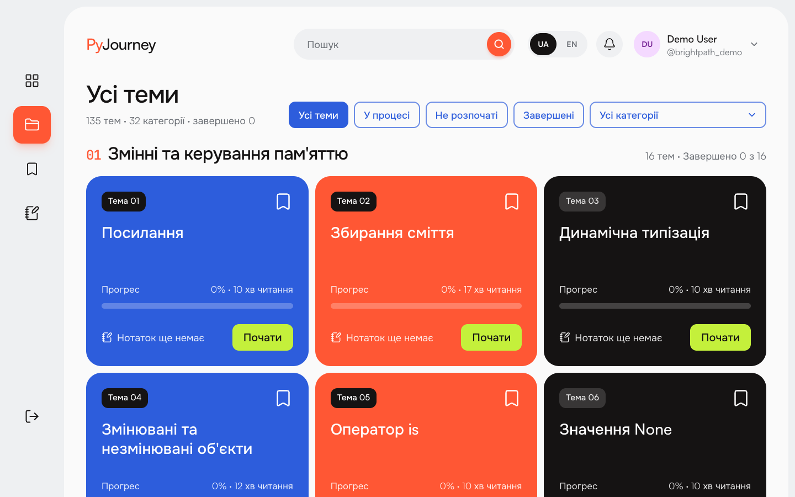
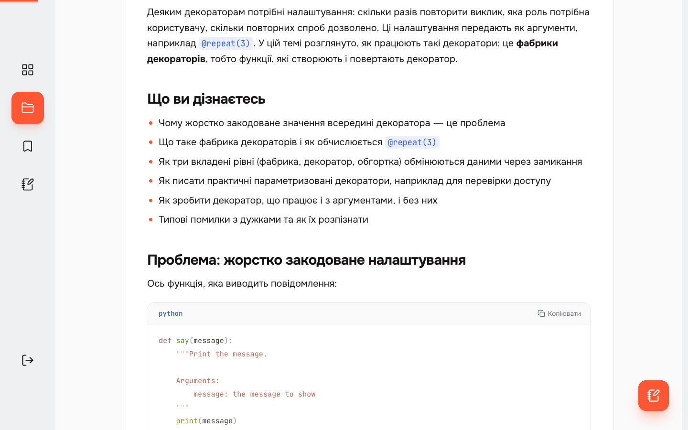
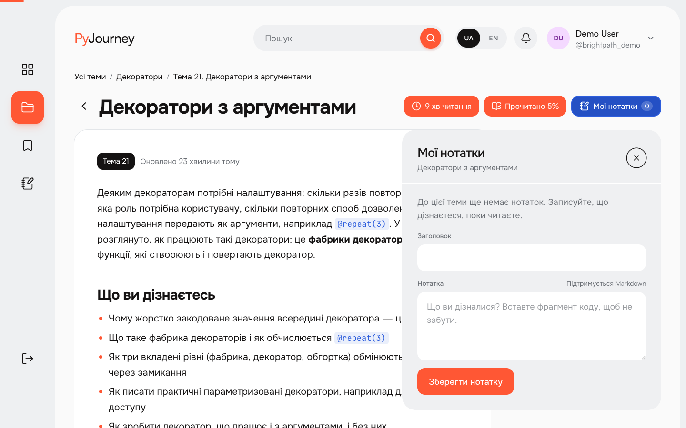

<div align="center">

# PyJourney

**Вивчайте Python тема за темою — українською та англійською.**

[English version](README.md) · [Усі теми](topics/README.md) · [API](#api)

</div>

PyJourney — вебзастосунок для поступового вивчення Python. У ньому **135 тем у 32 категоріях**: від змінних і керування пам'яттю до asyncio, патернів проєктування та NumPy. Кожну тему написано українською та англійською, а поруч із матеріалом можна вести власні нотатки.



## Можливості

- **135 тем двома мовами.** Кожна тема пояснює ідею, показує приклади коду, розбирає типові помилки й завершується вправами з розв'язками. Усі приклади запущено на Python 3.14, тож показаний вивід справжній.
- **32 категорії** в порядку курсу. На сторінці тем вони йдуть окремими розділами, а теми можна фільтрувати за категорією та прогресом.
- **Інтерфейс українською та англійською.** Мову можна змінити будь-коли перемикачем UA / EN. Текст тем, назви, дати й узгодження слів із числами (1 тема, 2 теми, 5 тем) підлаштовуються під обрану мову.
- **Власні нотатки** у форматі Markdown. Їх пишуть у бічній панелі просто поруч із темою.
- **Прогрес читання, нещодавні теми й рекомендації** на головній сторінці, а також закладки для тем, до яких хочеться повернутися.
- **Редактор для адміністратора.** Він дозволяє створювати й редагувати теми обома мовами, з переглядом Markdown наживо та вибором категорії.
- **Акаунти й ролі**: реєстрація, вхід через JWT, ролі `admin` і `user`.

| Читання теми | Нотатки поруч із матеріалом |
|---|---|
|  |  |

## Теми

Кожна категорія має власну папку в [`topics/uk`](topics/uk) та [`topics/en`](topics/en). Повний список тем із посиланнями — у [topics/README.md](topics/README.md).

| # | Категорія | Кількість тем | Читати |
|---|---|---|---|
| 01 | [Змінні та керування пам'яттю](topics/README.md#01) | 16 | [Українською](topics/uk/01-variables-and-memory-management) · [English](topics/en/01-variables-and-memory-management) |
| 02 | [Області видимості змінних](topics/README.md#02) | 2 | [Українською](topics/uk/02-variable-scopes) · [English](topics/en/02-variable-scopes) |
| 03 | [Замикання](topics/README.md#03) | 1 | [Українською](topics/uk/03-closures) · [English](topics/en/03-closures) |
| 04 | [Декоратори](topics/README.md#04) | 3 | [Українською](topics/uk/04-decorators) · [English](topics/en/04-decorators) |
| 05 | [Типи послідовностей](topics/README.md#05) | 4 | [Українською](topics/uk/05-sequence-types) · [English](topics/en/05-sequence-types) |
| 06 | [Ітеровані об'єкти та ітератори](topics/README.md#06) | 3 | [Українською](topics/uk/06-iterables-and-iterators) · [English](topics/en/06-iterables-and-iterators) |
| 07 | [Генератори](topics/README.md#07) | 2 | [Українською](topics/uk/07-generators) · [English](topics/en/07-generators) |
| 08 | [Менеджери контексту](topics/README.md#08) | 1 | [Українською](topics/uk/08-context-managers) · [English](topics/en/08-context-managers) |
| 09 | [Багатопотоковість і багатопроцесність](topics/README.md#09) | 6 | [Українською](topics/uk/09-multithreading-and-multiprocessing) · [English](topics/en/09-multithreading-and-multiprocessing) |
| 10 | [Класи та об'єкти](topics/README.md#10) | 9 | [Українською](topics/uk/10-classes-and-objects) · [English](topics/en/10-classes-and-objects) |
| 11 | [Спеціальні методи](topics/README.md#11) | 6 | [Українською](topics/uk/11-special-methods) · [English](topics/en/11-special-methods) |
| 12 | [Властивості (property)](topics/README.md#12) | 4 | [Українською](topics/uk/12-property) · [English](topics/en/12-property) |
| 13 | [Одиночне успадкування](topics/README.md#13) | 5 | [Українською](topics/uk/13-single-inheritance) · [English](topics/en/13-single-inheritance) |
| 14 | [Переліки (enum)](topics/README.md#14) | 4 | [Українською](topics/uk/14-enumerations) · [English](topics/en/14-enumerations) |
| 15 | [Принципи SOLID](topics/README.md#15) | 5 | [Українською](topics/uk/15-solid-principles) · [English](topics/en/15-solid-principles) |
| 16 | [Множинне успадкування](topics/README.md#16) | 1 | [Українською](topics/uk/16-multiple-inheritance) · [English](topics/en/16-multiple-inheritance) |
| 17 | [Дескриптори](topics/README.md#17) | 2 | [Українською](topics/uk/17-descriptors) · [English](topics/en/17-descriptors) |
| 18 | [Метапрограмування](topics/README.md#18) | 4 | [Українською](topics/uk/18-meta-programming) · [English](topics/en/18-meta-programming) |
| 19 | [Винятки](topics/README.md#19) | 5 | [Українською](topics/uk/19-exceptions) · [English](topics/en/19-exceptions) |
| 20 | [Вступ до unittest](topics/README.md#20) | 4 | [Українською](topics/uk/20-introduction-to-unittest) · [English](topics/en/20-introduction-to-unittest) |
| 21 | [Методи assert](topics/README.md#21) | 7 | [Українською](topics/uk/21-assert-methods) · [English](topics/en/21-assert-methods) |
| 22 | [Тестові дублери](topics/README.md#22) | 4 | [Українською](topics/uk/22-test-doubles) · [English](topics/en/22-test-doubles) |
| 23 | [Покриття тестами та параметризовані тести](topics/README.md#23) | 2 | [Українською](topics/uk/23-test-coverage-and-parameterized-tests) · [English](topics/en/23-test-coverage-and-parameterized-tests) |
| 24 | [Основи регулярних виразів](topics/README.md#24) | 4 | [Українською](topics/uk/24-basic-regular-expressions) · [English](topics/en/24-basic-regular-expressions) |
| 25 | [Квантифікатори](topics/README.md#25) | 3 | [Українською](topics/uk/25-quantifiers) · [English](topics/en/25-quantifiers) |
| 26 | [Набори та діапазони символів](topics/README.md#26) | 1 | [Українською](topics/uk/26-sets-and-ranges) · [English](topics/en/26-sets-and-ranges) |
| 27 | [Групування](topics/README.md#27) | 4 | [Українською](topics/uk/27-groupings) · [English](topics/en/27-groupings) |
| 28 | [Перегляд уперед і назад](topics/README.md#28) | 2 | [Українською](topics/uk/28-look-around) · [English](topics/en/28-look-around) |
| 29 | [Функції регулярних виразів](topics/README.md#29) | 9 | [Українською](topics/uk/29-regex-functions) · [English](topics/en/29-regex-functions) |
| 30 | [asyncio — асинхронний ввід-вивід](topics/README.md#30) | 1 | [Українською](topics/uk/30-asyncio) · [English](topics/en/30-asyncio) |
| 31 | [Патерни проєктування](topics/README.md#31) | 10 | [Українською](topics/uk/31-design-patterns) · [English](topics/en/31-design-patterns) |
| 32 | [NumPy](topics/README.md#32) | 1 | [Українською](topics/uk/32-numpy) · [English](topics/en/32-numpy) |

Матеріал адаптовано й доповнено на основі [pythontutorial.net](https://www.pythontutorial.net/), [Refactoring.Guru](https://refactoring.guru/uk/design-patterns) (патерни проєктування), [numpy.org](https://numpy.org/) та [docs.python.org](https://docs.python.org/3/). Джерело кожної теми вказано в кінці її файлу.

## Технології

| Частина | Технології |
|---|---|
| Бекенд | Python 3.12, FastAPI, SQLAlchemy, Alembic, Pydantic, PyJWT, pwdlib (Argon2) |
| База даних | PostgreSQL 13, pgAdmin |
| Фронтенд | React 19, TypeScript, Vite, TanStack Router, TanStack Query, Tailwind CSS 4 |
| Контент | Markdown із розширеннями GitHub, підсвічування коду Shiki |
| Інструменти | Docker Compose, Biome, React Compiler |

## Структура проєкту

```text
PyJourney/
├── app/                    бекенд на FastAPI
│   ├── alembic/            міграції бази даних
│   ├── routes/             auth, categories, topics, notes
│   ├── schemas/            моделі запитів і відповідей Pydantic
│   ├── models.py           моделі SQLAlchemy
│   ├── seed_topics.py      завантажує папку topics/ у базу даних
│   └── main.py
├── frontend/               застосунок на React
│   └── src/
│       ├── routes/         сторінки
│       ├── features/       теми, нотатки, профіль, автентифікація
│       ├── components/     макет, UI-компоненти, рендеринг Markdown
│       └── lib/            API-клієнт, запити, переклади
├── topics/                 навчальний матеріал
│   ├── categories.json     назви категорій обома мовами
│   ├── en/                 теми англійською
│   └── uk/                 теми українською
├── design/                 макети дизайну
├── docker-compose.yml
└── Dockerfile
```

## Запуск

Потрібні [Docker](https://www.docker.com/) із Docker Compose та [Node.js](https://nodejs.org/) 22.12 або новіший.

**1. Створіть файл `.env`** у корені проєкту:

```bash
DB_HOST=db
DB_NAME=devdb
DB_USER=devuser
DB_PASS=changeme
DATABASE_URL=postgresql://devuser:changeme@db:5432/devdb
SECRET_KEY=replace-with-a-long-random-string
PGADMIN_DEFAULT_EMAIL=admin@example.com
PGADMIN_DEFAULT_PASSWORD=changeme
```

Секретний ключ можна згенерувати командою `python3 -c "import secrets; print(secrets.token_hex(32))"`.

**2. Запустіть бекенд, базу даних і pgAdmin:**

```bash
docker compose up -d --build
```

**3. Підготуйте схему бази даних.** На новій базі API саме створює таблиці під час запуску, тому достатньо позначити міграції як застосовані:

```bash
docker compose exec app alembic stamp head
```

Якщо ви оновлюєте наявну базу зі старішої версії, натомість виконайте `docker compose exec app alembic upgrade head`.

**4. Завантажте теми:**

```bash
docker compose exec app python seed_topics.py
```

**5. Запустіть фронтенд:**

```bash
cd frontend
npm install
npm run dev
```

Відкрийте <http://localhost:5500> і створіть акаунт.

**6. Зробіть себе адміністратором**, щоб створювати й редагувати теми:

```bash
docker compose exec db psql -U devuser -d devdb -c "UPDATE users SET role = 'admin' WHERE username = 'your_username';"
```

| Сервіс | Адреса |
|---|---|
| Вебзастосунок | <http://localhost:5500> |
| API та Swagger UI | <http://localhost:8000/docs> |
| PostgreSQL | `localhost:5001` |
| pgAdmin | <http://localhost:5050> |

## Робота з темами

Кожна тема — це Markdown-файл, що починається з рядка `# Назва`. В обох мовах тема має однакову назву файлу:

```text
topics/uk/04-decorators/02-python-decorator-with-arguments.md
topics/en/04-decorators/02-python-decorator-with-arguments.md
```

Числа на початку назв задають порядок категорій і тем. Назви категорій зберігаються в [`topics/categories.json`](topics/categories.json).

Після того як ви додали або змінили файли, завантажте їх у базу знову:

```bash
docker compose exec app python seed_topics.py
```

Скрипт оновлює наявні теми за їхнім шляхом, тому номери тем і нотатки користувачів зберігаються. Якщо тема є лише однією мовою, скрипт зупиниться з помилкою. Щоб почати з нуля, додайте `--reset`: перед завантаженням він видаляє **всі нотатки, теми й категорії**.

Адміністратори також можуть створювати й редагувати теми прямо в застосунку. Такі зміни зберігаються лише в базі даних, тож перенесіть їх у Markdown-файли, якщо хочете мати їх у репозиторії.

## API

Інтерактивна документація доступна за адресою <http://localhost:8000/docs>.

| Метод | Шлях | Доступ | Опис |
|---|---|---|---|
| `POST` | `/auth/` | усі | Реєстрація |
| `POST` | `/auth/token` | усі | Вхід і отримання JWT |
| `GET` | `/auth/me` | користувач | Поточний користувач |
| `GET` | `/categories/` | усі | Категорії в порядку курсу |
| `GET` | `/topics/` | усі | Список тем із назвами, вступом і часом читання (`category_id`, `skip`, `limit`) |
| `GET` | `/topics/topics/{id}` | усі | Повна тема обома мовами |
| `POST` | `/topics/topics` | адмін | Створити тему |
| `PUT` | `/topics/topics/{id}` | адмін | Оновити тему |
| `DELETE` | `/topics/topics/{id}` | адмін | Видалити тему разом із нотатками |
| `GET` | `/notes/` | користувач | Ваші нотатки |
| `POST` | `/notes/notes` | користувач | Створити нотатку |
| `PUT` | `/notes/notes/{id}` | користувач | Оновити свою нотатку |
| `DELETE` | `/notes/notes/{id}` | користувач | Видалити свою нотатку |

## Скрипти фронтенду

| Команда | Що робить |
|---|---|
| `npm run dev` | Сервер розробки на порту 5500, запити `/api` переадресовуються на бекенд |
| `npm run build` | Перевірка типів і продакшн-збірка |
| `npm run typecheck` | Перевірка TypeScript |
| `npm run lint` | Перевірка коду й форматування Biome |
| `npm run format` | Виправлення форматування Biome |
